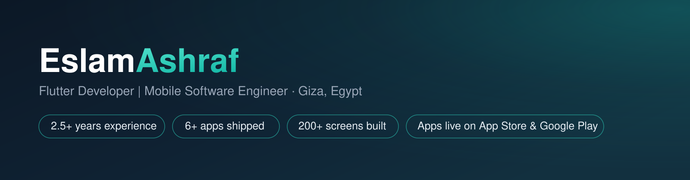

  

  
  
  
  

## About

Flutter Developer with **2.5 years of experience** building and shipping cross-platform mobile apps for **Android and iOS**. I turn UI/UX designs into pixel-perfect, reliable products, with a strong focus on clean architecture and performance. Apps I built are live on the App Store and Google Play.

## Tech Stack

  
  
  
  
  
  
  
  
  
  

`Clean Architecture` · `SOLID` · `MVVM` · `REST APIs & Dio` · `Token refresh flows` · `Push notifications (FCM)` · `Arabic/English localization & RTL` · `Secure local storage` · `Google Sign-In & deep linking`

## Featured Apps

| App | What it is | Highlights | Get it |
| --- | --- | --- | --- |
| **Farrah Now** | Social travel app | Google Maps & geolocation, media sharing, real-time push notifications | [Google Play](https://play.google.com/store/apps/details?id=com.wanderr.app&hl=en) · [App Store](https://apps.apple.com/us/app/farrah-now/id6760767174) |
| **MV Limousine** | Car-rental platform | Two service tiers, real-time pricing, driver availability, multi-step booking over a Laravel REST API | [Google Play](https://play.google.com/store/apps/details?id=com.Triple.MVLimousine&hl=en) · [App Store](https://apps.apple.com/eg/app/mv-limousine/id6757188466) |
| **BabyTrack** | Baby-care app | On-device TensorFlow Lite cry detection, growth tracking & analytics, Arabic/English with full RTL support | [Google Play](https://play.google.com/store/apps/details?id=com.babytrackk.app) · [App Store](https://apps.apple.com/us/app/baby-track/id6770317630) |
| **Foteek** | Footwear e-commerce app | Brand discovery & filters, wishlist, cart, live order tracking | [Google Play](https://play.google.com/store/apps/details?id=com.footek.triple&hl=en) · [App Store](https://apps.apple.com/au/app/footek/id6795145200) |
| **GoBite** | Arabic food-ordering app | Full RTL interface, restaurant menus with offers, cart & order tracking | [Google Play](https://play.google.com/store/apps/details?id=com.gobite.triple) · [App Store](https://apps.apple.com/ng/app/gobite/id6800733653) |
| **RBCS** | Medical e-learning app | Class catalogue by specialty, video previews, mentor profiles & ratings | Store links not provided |

## Open Source

- [**auth_logic**](https://pub.dev/packages/auth_logic) - production-ready Flutter authentication package on pub.dev: login, register and OTP flows with auto token refresh, retry with backoff and network logs, built with MVVM + Cubit

## Public Projects

- [**FlutterTask**](https://github.com/EslaamAshraaf/FlutterTask) - employee attendance management with Firebase, Clean Architecture and Cubit
- [**Eslam-Ashraf-portfolio**](https://github.com/EslaamAshraaf/Eslam-Ashraf-portfolio) - my web portfolio

---

Open to Flutter and mobile development opportunities · <a href="mailto:eslaamashraaf09@gmail.com">eslaamashraaf09@gmail.com</a>

